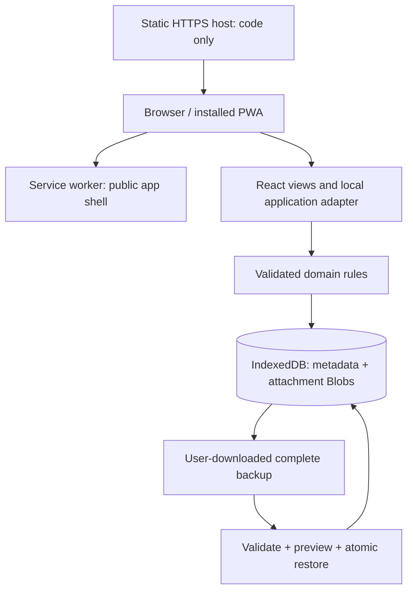

# hima — architecture

Current baseline: **local-first static app, version 0.2**. Supersedes the PostgreSQL/Fastify/cloud architecture archived in `legacy/postgres/guides`.

There is no planner API, application server, identity service, remote database, upload bucket, telemetry, or third-party font request. The optional local preview process serves files from `dist/web` only. Production deployment publishes that directory to a static HTTPS host; it must never publish `.runtime`, `legacy`, backups, or the repository root.

## Code boundaries

- `apps/web`: React UI, safe Markdown renderer, local adapter, settings, theme tokens, offline status.
- `packages/contracts`: authored TypeBox data schemas and shared types.
- `packages/domain`: task graph, date-only recurrence, progress calculations.
- `packages/local`: IndexedDB transactions, file bytes, quotas, receipts, history, backups, validation.
- `scripts`: Vite build finishing step, generated service worker, static preview launcher.
- `tests`: deterministic domain and IndexedDB tests; no database service is needed.
- `legacy/postgres`: historical implementation only, excluded from the active build and dependencies.

## Local persistence

Database: `dayweave-device`, IndexedDB version 1. Stores: `state` (one versioned workspace record) and `blobs` (attachment bytes keyed by UUID). The state holds bounded entities, file metadata, generation checkpoints, recent activity and a small retry ledger. Blob bytes are not duplicated into task/note records or read on ordinary workspace loads.

Each mutation reads, validates, and writes inside one readwrite transaction. IndexedDB serializes overlapping transactions across tabs. A successful promise resolves only at transaction completion. Exceptions and quota errors abort the whole transaction. Existing-record saves compare versions, preventing silent stale overwrites. Restore uses a workspace-revision precondition and increments imported entity versions beyond existing versions, invalidating stale editors.

The v1 metadata envelope trades some write amplification for simpler atomic cross-entity validation. It is bounded to 20 MB, 10,000 entities, 500 activity records and 16 retry receipts; attachments have separate limits. If measured device performance warrants it, migrate entities to indexed per-record stores in a new IndexedDB upgrade transaction. Do not drop/recreate the database as a migration strategy. Blocked upgrades ask the user to close other tabs; old database handles close on `versionchange`.

## Offline and updates

The build generates a cache version from the application shell and precaches exactly the public HTML, hashed JS/CSS, manifest, and icons. Navigation loads the cached shell. Personal metadata and attachment bytes are stored only in IndexedDB, never in Cache Storage or a remote cache. `/api` is unused and blocked by the new worker.

A new worker remains waiting while the current version is in use. A visible Update app button appears outside editors; only explicit selection activates it and reloads. Activation removes only old hima public caches. No automatic reload interrupts an open editor. “Ready offline” follows the installed worker's cache-ready message. First installation requires access to the static files.

Recurrence catch-up runs on startup/focus/periodic visible refresh. Each transaction processes up to 500 calendar days toward a 90-day future horizon and retains an original-slot identity, so re-running does not duplicate or resurrect trashed occurrences. Very old series can take successive refreshes to finish catch-up. No background server jobs or closed-app notification delivery are promised.

## Data portability

Backup format `dayweave-device`, version 1: timezone, entity envelopes, recurrence checkpoints, and attachments with SHA-256 checksums/base64 bytes. Export reads one consistent metadata/blob snapshot. Restore checks format, schemas, IDs, limits, references, dependency graph, file hashes, and quotas before offering replacement. Metadata and files are replaced atomically only after explicit action, and only if the live revision still matches the reviewed workspace.

JSON backups are plaintext. They are meant to be saved privately and copied to another device for manual restoration. There is no hidden server copy or merge engine. A checksum detects damage; it does not authenticate a backup's author or encrypt its contents.

## Privacy and security boundaries

The trust boundary is the browser origin/profile and the user's device. Another site cannot directly read IndexedDB for this origin, but compromised same-origin code, a malicious browser extension, or access to an unlocked device can expose content. This is not an encrypted vault or an end-to-end-encryption claim.

Keep dependencies pinned, render text through React, disallow raw HTML and remote note images, allow only explicit safe link protocols, and use a restrictive CSP. No arbitrary user CSS/JS, dynamic script evaluation, remote embeds, or background integrations. Attachment originals download through short-lived Blob URLs as binary data; the app does not execute or parse them. Remove attachment blobs when explicitly removed or eligible parent Trash is emptied.

The static preview sets CSP, nosniff, no-referrer, frame denial and restricted device permissions. A host must apply equivalent response headers (example `_headers` file supplied); the HTML includes a CSP fallback. A same-origin host can still distribute altered code, so hosting access and update integrity matter even when content stays local. No deployment or external transmission is performed by this conversion.

Browser persistent-storage requests are user-triggered and may be denied. Clearing browser data, profile deletion, or device loss still removes local data. Backups—not persistence permission alone—provide recovery. An optional encrypted vault remains future work.

## Planning flow

Profile → AI plan import → copy local format prompt → user consults an external LLM → JSON file/paste → local schema and domain validation → explicit preview → atomic add-only commit → goal workspace. `packages/local/plan-import.ts` owns the exchange boundary. Imported strings are data, never executed; files cannot change preferences, run tools, fetch links or replace a workspace. LLM use is manual and governed by the selected provider when the user supplies information there.

`GoalWorkspace` renders linked work and explicit real-world outcome separately. `GoalPlanFields` edits plan data within the existing version-checked goal editor. `addGoalItem` commits a new task/note/routine and its goal link together. `packages/domain/planning.ts` selects ready next actions, finds missed plans and escapes CSV output. Routine goal progress includes generated occurrences through the current date, not future occurrences. Review dates and application rows are visible planning aids, not background alarms.

## Task handoff and completion

Task status moves with evidence use `moveTask`: prepare attachment bytes, then check entity version, prerequisites, completion rules and quotas in one IndexedDB transaction with task/checklist/note/blob writes. Cancelled dialogs never persist selected files. Ordinary task saves also enforce hold/completion rules on changed status or evidence; legacy unchanged completed tasks remain editable. Files required by a completed task cannot be removed until its status or requirements change.

### Optional Google Calendar connection
Settings → Connections provides an explicit Google Identity Services connection using a public web OAuth client ID and `calendar.readonly`. Google scripts load only after Connect is pressed. Short-lived access tokens remain in memory; never saved in IndexedDB, backups, browser storage, or service-worker caches. Only Google authentication and Calendar API hosts are permitted in the app CSP; the core planner still works offline.

Select a readable calendar and press Sync now. Sync pulls expanded recurring instances from 30 days ago through one year ahead (maximum 2,500 events), validates all pages, then commits atomically with a workspace revision check. Copies are keyed by actual calendar ID plus Google event ID. Events missing from the fetched window move to recoverable Trash; other calendars, native events and dates outside the window remain unchanged. Imported events are read-only and included in local backups. Disconnect revokes the in-memory token and retains copies; a separate action moves copies to Trash. Reconnect after reload/expiry. No background or two-way sync.

Google setup: enable Calendar API; keep External audience in Testing with each tester’s email; allow calendar.readonly; register the exact preview origin and eventual HTTPS deployment origin under the web client’s Authorized JavaScript origins. No client secret or redirect URI is used by this popup flow. Hosting and live account authorization remain external setup steps; automated tests do not verify Google consent.
