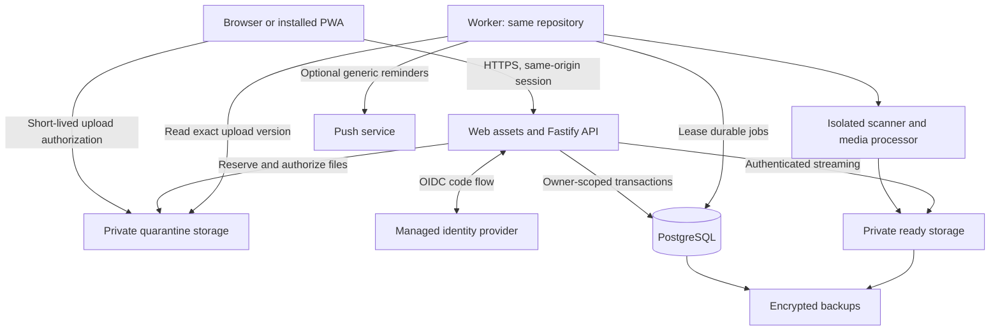

# Dayweave — Architecture

Status: proposed build baseline · Version 0.1 · 8 October 2026

**Implementation checkpoint:** [Working local prototype 0.1](PROTOTYPE.md) now exists. That guide records shipped behavior, local-only security boundaries, validation results, and explicit P0 gaps. The remaining requirements below are still beta targets, not claims that the first prototype implements them all.

Build a small modular application with one web/API deployable, one worker deployable from the same codebase, PostgreSQL, and private object storage. Managed identity verifies sign-in; the application owns authorization and sessions. This keeps operational complexity limited while separating untrusted media processing from interactive requests.

This document owns boundaries and operational decisions. [Technical specification](tech-spec.md) owns behavior/data contracts; [product](product.md) owns scope; [design](design.md) owns interface rules. No infrastructure has been provisioned by these documents.

## 1. System overview



Browser input, identity callbacks, uploaded files, job payloads, and provider responses are untrusted. A signed-in user is still untrusted with respect to every other user's data. Storage, database, and identity secrets stay server-side. An upload credential grants only a single bounded upload, never bucket reads or enumeration.

The worker can begin as one small process with separate bounded concurrency pools. Media parsers run in a child container/process with no application/database credentials, no outbound network, limited memory/CPU/time, and read-only access to the assigned input. Split this further only when measured load requires it.

## 2. Repository layout

```text
 dayweave/
   README.md
   product.md
   tech-spec.md
   architecture.md
   design.md
   apps/
     web/                 # React routes, components, CSS, PWA service worker
     server/              # Fastify routes, auth, static assets, composition
     worker/              # Queue runner, recurrence, reminders, export, cleanup
   packages/
     contracts/           # Types, authored schemas, error codes
     domain/              # Task transitions, dependencies, dates, progress
     db/                  # Tables, migrations, owner-scoped repositories
     ui/                  # Tokens and shared accessible primitives
   tests/
     integration/         # Real Postgres, API and security behavior
     journeys/            # Browser/mobile-critical flows
   infra/                 # Container/deploy configuration, no secrets
```

Use a simple workspace package manager and one lockfile; no build orchestration platform unless build time warrants it. The API serves built web assets and `/api/v1` from the same origin. Static content may later move behind a CDN without caching private API responses.

Dependency direction: routes → application services → domain/repositories → database/storage adapters. Domain logic does not import React, Fastify, or an identity SDK. Shared browser packages never import server secrets or database clients. API response DTOs are deliberate projections, not raw database rows.

## 3. Module responsibilities

| Module | Owns | Boundary |
|---|---|---|
| Identity/access | OIDC login, sessions, CSRF, account lifecycle | Produces trusted account context; never trusts a supplied owner ID |
| Planning | Areas, tasks, blocks, events, dependencies | Sole writer for task/date invariants |
| Routines | Rule preview, occurrence generation, exceptions | Same calculation engine for worker and API |
| Knowledge | Notes, links, attachment associations | No collaboration server or HTML execution |
| Progress | Goals, checklist/numeric/task calculations | Derived totals; atomic versioned entry changes |
| Files | Reservations, scanning states, delivery, quotas | Only Ready files can be delivered |
| Personalization | Templates, preferences, appearance validation | Structured settings only; no user code |
| Notifications | Reminder schedules, inbox, subscriptions | Durable jobs; external delivery best-effort |
| Data lifecycle | Export, trash, purge, account deletion | Auditable operations and retention controls |

No module directly writes another module's tables to bypass its invariants. Application services coordinate cross-module operations in one database transaction where atomicity is required.

## 4. Canonical writes and reads

### Complete a task

1. Validate session, CSRF, request shape, idempotency key, and If-Match.
2. Start an owner-scoped transaction; acquire the per-owner graph lock.
3. Return an existing operation receipt on an exact retry; otherwise load task and prerequisites.
4. Verify status, version, ownership and dependency readiness.
5. Update task, append activity, invalidate scheduled reminders, and insert any durable jobs with domain-specific dedupe keys.
6. Store the operation receipt and commit. Return the new task version and affected readiness summaries.
7. The UI replaces its optimistic row with acknowledged data. Worker failures cannot undo the committed completion.

### Read Today

Authenticate, compute today in the account zone, and issue bounded indexed queries for planned tasks, deadline items, waiting work, missed plans, and recent completions. Deduplicate server-side. Read readiness from dependencies rather than relying on a stale stored `blocked` flag. Include pagination/counts per section; don't fetch all history to compute a badge.

### Cross-device edits

PostgreSQL is the source of truth. P0 refreshes on navigation, focus, resume, and every 60 seconds while the app is visible. Mutation responses refresh relevant queries. No WebSocket service is needed. Use HTTP versions to detect conflicts; never silently use last-write-wins for notes or schedules. Preferences can show the same conflict/reload choice.

## 5. Authentication and account isolation

Use a managed OIDC provider with a maintained server library. During M0 choose a provider that supports consumer sign-in, verified identity, account recovery, revocation, and the intended deployment region. Default beta sign-in can be Google through OIDC; passwords and email delivery are not implemented in this app. Verify issuer, audience, signature, nonce, state, PKCE and redirect allowlist. Map identity by issuer + subject; never automatically merge accounts solely because an email matches.

After verified login, mint an opaque random session secret, store only its hash, rotate at sign-in/security changes, and send a host-only `__Host-` cookie with `Secure`, `HttpOnly`, `Path=/`, and `SameSite=Lax`. Proposed session policy: 7-day idle, 30-day absolute lifetime; logout/revoke takes effect server-side immediately. Account deletion and export require a recent authentication within 10 minutes. Provide session listing and “Sign out other devices.” Session handling follows the [OWASP session guidance](https://cheatsheetseries.owasp.org/cheatsheets/Session_Management_Cheat_Sheet.html).

For cookie-authenticated mutations, require an exact allowed Origin and a session-bound CSRF token in a custom header; reject simple cross-site content types. OAuth callback validation is its own protected flow. No GET route changes application state. CORS is closed by default. Never put bearer tokens in browser localStorage or URLs.

Every repository operation requires trusted account context. Use a non-owner, non-superuser runtime database role without BYPASSRLS; enable and force row-level security on private tables. Set transaction-local owner context from the verified session with parameterized `set_config(..., true)`. Policies use the context in both `USING` and `WITH CHECK`; missing context fails closed. Composite foreign keys reinforce same-owner relationships. RLS is defense in depth against query mistakes, not a substitute for parameterization or application authorization. PostgreSQL documents role bypass behavior and policy semantics in its [row security reference](https://www.postgresql.org/docs/current/ddl-rowsecurity.html).

The migration role is separate and unavailable at runtime. The scheduler has a narrowly scoped function/role to lease jobs across accounts; it cannot read private note/task contents directly. Once a job is leased, the worker enters an explicit owner-scoped transaction and rechecks account state and entity ownership. No request can submit a raw job or arbitrary worker owner context. Test job-owner tampering as well as HTTP ID tampering.

## 6. Threats and required controls

| Threat | Required controls | Verification |
|---|---|---|
| Cross-account object access | Owner context, RLS, composite FKs, authorized file streaming | Two-account API/database tests, including joins/search/export |
| Session theft / CSRF | Secure opaque cookies, rotation/revocation, Origin + CSRF checks, no token logging | Cookie/expiry tests, cross-origin mutation denial |
| Stored XSS | Plain titles, safe Markdown, no raw HTML, safe URL protocols, strict CSP | Hostile Markdown/title/link fixtures |
| Malicious uploads | Quarantine, immutable promotion, scanning, bounded parsers, private delivery | MIME spoof, overwrite-after-scan, oversized/hostile media tests |
| SSRF | No remote URL imports/unfurls; push egress validation and network restrictions | Private-network, redirect and rebinding fixtures |
| Lost edits / duplicate work | Versions, idempotency receipts, unique domain keys, atomic jobs | Races, retry after timeout, worker crash tests |
| Resource exhaustion | Body/file/query limits, quotas, rate limits, job concurrency and timeouts | Concurrent upload/reservation and large-history tests |
| Data leakage via logs/backups | Content-free logs, limited retention, encrypted storage, restricted operators | Logging review, access audit, restore/deletion drill |
| Supply-chain compromise | Lockfile, least dependencies, reviewed upgrades, CI scanning, no secrets in client | Dependency/license inventory and secret scans |

Security headers: HTTPS/HSTS, restrictive CSP, `frame-ancestors 'none'`, `object-src 'none'`, `base-uri 'none'`, `X-Content-Type-Options: nosniff`, and `Referrer-Policy: no-referrer`. CSP allows self-hosted scripts/styles plus only explicitly required storage upload/connect origins; use hashed styles if a UI primitive requires them. No broad `unsafe-eval` or third-party analytics scripts. Limit device permissions to features actually used.

Initial rate-limit defaults: 120 reads/minute and 30 writes/minute/account, 10 upload starts/minute, 10 login starts/10 minutes/IP, one export/hour. Return useful 429 responses. Tune with real usage. A single API replica can use bounded in-memory counters behind edge limits; before adding replicas, enforce shared counters/quotas or equivalent gateway policy. Quotas themselves always live in PostgreSQL transactions.

Encrypt transport, database volumes/backups, and object storage using managed keys. Restrict operational access and audit exceptional access. **P0 is not end-to-end encrypted:** the server processes content for search and reminders. Do not market it otherwise. Adding E2EE would require redesigning search, recovery, media handling, and cross-device keys.

## 7. Durable background work

Jobs use transactional insertion alongside the initiating mutation. Lease ready jobs with `FOR UPDATE SKIP LOCKED`, set lease expiry, and commit before external work. Handlers recheck the latest record version and account state, renew long leases, and commit completion with dedupe constraints. Retry with exponential backoff and jitter, maximum eight attempts, then dead-letter and alert. Cleanup jobs must also be idempotent.

Queue workloads: routine materialization, reminder delivery, scanning/thumbnailing, exports, expired-upload cleanup, trash purges, account deletion. No API request blocks on a media scan or large export. A recurring sweep repairs missed routine/reminder/cleanup scheduling; job rows, not process timers, hold authority. Worker outage exposes queue delay metrics and never makes the app claim a reminder was delivered.

Run recurrence and reminder jobs with priority over media/export jobs. Start with concurrency 4 for metadata jobs and 1 for media/export, then measure. File and export work streams bytes rather than loading entire accounts/videos into RAM.

## 8. PWA and native path

P0 includes a manifest, icons, HTTPS, responsive layouts, standalone-safe navigation, and a service worker caching only versioned public assets and a generic offline page. All `/api`, authentication, file, export, and private-content requests are network-only with `Cache-Control: no-store`. No persistent private IndexedDB cache in P0. In-memory content may remain until logout/reload; show Offline and disable writes while disconnected. On logout clear client state, caches with private data if any, and active subscriptions for that session as applicable.

Service-worker upgrades announce an available update and avoid reloading an unsaved editor. Retain compatible old assets during rollout. PWA installation and capabilities vary by device/browser, so detect support and show tested instructions instead of promising a universal Install button. [PWA installation guide](https://web.dev/learn/pwa/installation).

P1 offline work requires a separate design gate: per-account IndexedDB, explicit “Keep data on this device,” data minimization, logout cleanup, durable mutation IDs, conflict UI, tombstone retention, queue age limits, and account-switch tests. Browser storage cannot be promised confidential against an unlocked device or XSS. Do not add background sync and call conflict handling finished.

P1 native distribution uses Capacitor with bundled web assets and a small allowlisted plugin surface. It requires platform SDKs, signing, store accounts/review, and device QA; a PWA alone is not an app-store release. [Capacitor documentation](https://capacitorjs.com/docs).

Native auth is a separate adapter: system-browser authorization code + PKCE, verified app/universal-link callback, short-lived access token in memory and rotated refresh token in OS secure storage, server-side revocation, narrowly allowed API origins. Do not weaken web cookie/CSRF protections to make a WebView work. Native notification and file-picker adapters must pass permissions/denial/revocation tests. No remote executable-code updates or unrestricted navigation inside the privileged shell.

## 9. Retention, portability, and recovery

Tasks, notes, events, goals, and attachments use a 30-day trash window. Archive retains content indefinitely until deleted. Deleted linked prerequisites follow the explicit dependency-removal rule. Keep lightweight recurrence tombstones while their series can still generate the occurrence; account deletion removes them too. Trashed attachments count against quota until purge; show storage usage and Empty trash.

Account export creates a versioned ZIP containing a JSON manifest, all user-owned product entities and relationships, Markdown notes, CSV task/progress tables, preferences, recurrence exceptions/history, and Ready attachments with checksums. Exclude session secrets, push credentials, and internal job payloads. Neutralize spreadsheet formula prefixes in CSV fields. Export is streamed to private storage, expires after 24 hours, and downloads through a reauthenticated endpoint. Report pending/rejected uploads in the manifest. Use a repeatable-read snapshot for metadata, immutable file versions, and temporary retention pins so concurrent file deletion cannot silently corrupt an export; account deletion cancels it. Test export completeness against a fixture. A restore/import UI is P1; beta export remains human-readable and machine-parseable.

Account deletion requires recent authentication and explicit confirmation. Immediately mark deleting, revoke all sessions, cancel jobs, stop login from recreating the same account until erasure completes, and deny reads. Purge active database rows, quarantine/Ready objects, exports, and subscriptions within seven days; provider identity deletion is handled according to the chosen identity-provider arrangement and disclosed to the user. Ordinary item trash recovery does not reverse account deletion.

Proposed backup policy: daily encrypted backups with point-in-time recovery where supported; 30-day retention; object versioning/lifecycle aligned with that window. Initial recovery targets: RPO ≤24 hours and RTO ≤8 hours. Verify actual provider capability/cost before beta and measure a restore drill. After restoration, replay an access-restricted erasure ledger before enabling traffic so deleted accounts do not reappear. Disclose that deleted data ages out of backups within 30 days. Retain only the minimal erasure identifiers needed through the recovery window.

Keep content-free operational logs for 14 days and security events for 30 days. User-facing task activity lives with its parent content and follows its deletion. Logs contain request IDs, status codes, durations and opaque IDs, never titles, note bodies, filenames, cookies, auth codes, tokens, or signed URLs.

## 10. Deployment and operations

Use separate local, staging, and production databases/buckets/identity clients. Choose one deployment region aligned with the intended users and privacy needs. Local development can use containerized PostgreSQL and S3-compatible test storage. Never seed local/staging from production personal data.

Deploy sequence:

1. Typecheck, lint, unit/integration/journey checks, dependency and secret scan, build and bundle-budget report.
2. Back up and apply reviewed, backward-compatible migrations using the dedicated migration role.
3. Deploy API and worker images from the same release; check liveness/readiness and queue processing.
4. Run smoke checks with synthetic accounts; verify account isolation, login, create/complete, and upload readiness.
5. Retain previous static assets/API compatibility; roll back application images if needed. Repair destructive migrations by forward migration or verified recovery, not an assumed down script.

Use expand → backfill → switch → contract for incompatible schema changes. Version job payloads and support old queued versions through rollout. Health endpoints reveal no credentials or personal data; readiness checks dependencies and migration compatibility. Alert on error rate, queue lag/dead letters, repeated auth failures, storage growth, and backup failure.

Provider selection during M0 must produce a small cost worksheet: app and worker compute, database/backups, private storage/egress, identity active users, and scanning capacity. No current price is assumed here. Media/egress is likely to grow faster than task metadata; quotas and resize policies keep it bounded. Set a spending alert before public signup.

## 11. Key decisions and review triggers

| Decision | Benefit | Tradeoff / revisit when |
|---|---|---|
| React/Vite SPA | Reusable UI, predictable static deployment | More client JS than minimal vanilla; replace only if measured budget fails |
| Fastify + PostgreSQL monolith | Clear API, transactional invariants, few services | Operate a server and database; keep schema/query discipline |
| Private owner model | Simple comprehensible permissions | Household/shared planning needs a separately designed membership model |
| PWA before native | Fast shared release path | Device capabilities differ; native work needed for store distribution |
| Online-first P0 | Avoids early sync complexity and local private caches | Network required to load/save; offline is an explicit later investment |
| Markdown notes | Small editor and portable text | Less rich than block editors; no simultaneous editing |
| Fixed workflow and typed settings | Predictable behavior and safe customization | No arbitrary statuses, scripts, or plugin marketplace |
| DB-backed jobs | Durable work without a broker | Split queues/services only after measured contention |
| No video transcoding | Lower CPU, simpler pipeline | Some codecs download instead of preview; revisitable with real demand |

Review this baseline before M0 implementation with the chosen identity/hosting provider, before offline or native expansion, and whenever sharing, E2EE, external calendar sync, or arbitrary automation enters scope. The existing specification is sufficient to start the private web/PWA foundation without resolving every later feature.


## Local prototype adapter — implementation decision

Prototype 0.1 uses the specified React/Vite, Fastify, PostgreSQL, TypeBox, and Luxon stack. To make the first build usable without cloud credentials, it adds a loopback-only local-session adapter and private filesystem downloads. Production mode refuses this adapter. Owner transactions, forced RLS under a non-superuser role, version checks, operation receipts, server-side graph rules, and safe rendering are implemented and tested.

The prototype uses owner-keyed validated JSONB entity envelopes through parameterized SQL rather than the full normalized Drizzle model. It also uses an in-process routine refresher rather than claiming the durable worker/notification system is finished. These local adapters must be replaced or extended before a public beta; the detailed migration and release gaps are recorded in [PROTOTYPE.md](PROTOTYPE.md). No account identity, content, or deployment configuration was copied from the inspiration project.
